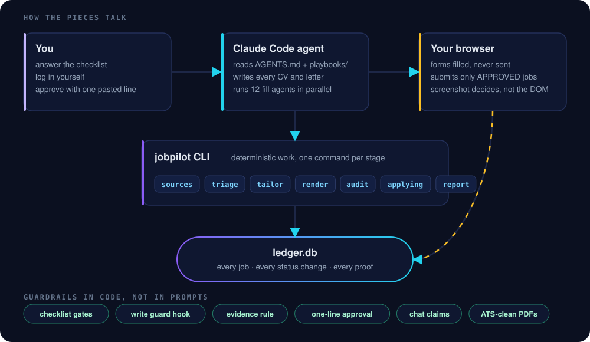
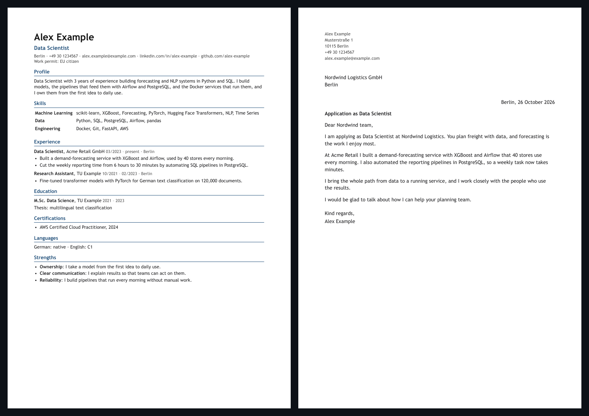

<p align="center">
  
</p>

<p align="center">
  
  
  
  
  
</p>

applyjob turns Claude Code into a job-search assistant you can actually trust with your name on it. You give it
your CV once. It finds jobs, throws out the ones that don't fit, writes a CV and cover letter for each remaining job,
checks every line of both against your real history, fills the application forms in your own browser, and waits for
you to approve them in one message. Then it proves each application was really sent.

The code does everything that can be checked. The agent does the parts that need judgement: reading an advert,
writing a letter, filling a form. Every rule that matters is enforced in Python, not left to a prompt.

## Why I built it

I prepared more than 300 job applications in Germany with AI help, and the failures taught me more than the successes:

- An agent once marked **84 applications as sent that were never sent**. Nobody lied; it just took a filled form for
  a finished one. So applyjob refuses to mark anything sent without a quoted confirmation page or e-mail.
- A PDF engine silently turned "Air**fl**ow" into a ligature character. A human sees "Airflow", an ATS keyword search
  doesn't. So every PDF is now checked at the character level, and the font's character map is rewritten to plain ASCII.
- Long chats drift. By message 400 an agent forgets the rule from message 3. So the rules live in code (stage gates,
  a write-guard hook, an evidence check), and the prompt only has to point at them.
- Parallel chats collide. Two of them once moved the same folder in opposite directions within a minute. So chats
  now claim the batch they work on.

## A session

<p align="center">
  
</p>

You say "hi". It asks for your master CV, reads it, and then asks only what the CV can't tell it, as a short list.
After that you talk to it normally: *"find data analyst jobs in Munich"*, *"write the good ones"*, *"apply"*.

## How the pieces talk

<p align="center">
  
</p>

- **You** answer the checklist, log in to your own accounts, and approve submissions by pasting back one line.
- **The agent** (Claude Code) reads `AGENTS.md`, then the playbook for the stage it's on. It writes the documents and
  runs up to 12 fill agents in parallel, one group of forms each.
- **The CLI** (`python3 -m applyjob ...`) does the deterministic work: job APIs, triage rules, rendering, the audit,
  the queue.
- **The ledger** (`workspace/ledger.db`, SQLite) is the only source of truth: every job, every status change, every
  piece of proof. The tracker spreadsheet is generated from it and never edited by hand.

## Design decisions

| Problem | Decision | Where |
|---|---|---|
| The agent invents a number or a tool | Every number in a CV or letter must exist in that role's profile entry; a bullet may only name tools that role used | `audit.py` |
| "Looks done" is not done | `SUBMITTED` needs `page: <quote>` or `mail: <subject>`; badges and "clicked submit" are rejected | `ledger.py` |
| Approving job by job is slow; approving nothing is unsafe | You approve the whole batch once, before filling, by pasting one line that names every job. Parallel agents then fill and submit only those; `record SUBMITTED` refuses any other | `applying.py`, `cli.py` |
| Forgotten personal details | A 97-item checklist; each stage refuses to run until its items are answered | `checklist.py` |
| Files scattered by long or parallel chats | A PreToolUse hook blocks writes outside the allowed folders; chats claim batches | `guard.py`, `workspace.py` |
| ATS can't read the PDF | A font self-test, a ToUnicode rewrite to ASCII, and an audit that blocks ligatures and look-alike hyphens | `render.py` |
| The checker is wrong sometimes | Findings are atomic (one problem, one place, evidence, fix), and the playbook says: prove the checker right before "fixing" a document | `audit.py`, `playbooks/40_audit.md` |
| Scraping gets accounts banned | Official job APIs first; LinkedIn only through your own job-alert e-mails or pages you open; no Easy Apply loops | `sources.py`, `playbooks/10_search.md` |

## The checklist

`applyjob/checklist.py` lists every detail a real application form has ever asked for: name, salutation, date of
birth, nationality, address, work permit and its expiry, sponsorship, start date, notice period, gross salary, work
mode, office days, relocation, travel, driver's licence, years with and without internships, years per field, people
managed, a reference, certificates, talent-pool consent, LinkedIn and e-mail preferences.

```text
$ python3 -m applyjob profile
core       32/32  complete
apply      19/27  INCOMPLETE
linkedin    5/7   INCOMPLETE
email       3/4   INCOMPLETE
optional    9/27  (blocks nothing)
```

Searching and writing need `core`; filling forms needs `apply`. Questions that don't apply to you are skipped (no
relocation question if you don't relocate, no permit expiry for EU citizens). Answer `-` to decline a question; forms
then leave that field to you.

## What comes out

<p align="center">
  
</p>

A text-based A4 CV (up to two pages) and a one-page letter per job, plus `audit.json` with every finding and a
`findings.xlsx` for the whole batch. The sample is generated from `examples/profile.example.json`, a fictional person.

## Pipeline

| Stage | You say | It does | Playbook |
|---|---|---|---|
| 0 Onboarding | "hi" + your CV | builds your profile, asks what's missing | `00_onboarding.md` |
| 1 Search | "find ML jobs in Germany" | 24,443 known company job boards in one command, the federal job board, your sheets, your LinkedIn alerts | `10_search.md` |
| 2 Triage | "go" | GOOD / CHECK / REMOVED, each with a reason; the agent reads every CHECK | `20_triage.md` |
| 3 Tailor | "write them" | one spec per job; summary, bullets and a 4-paragraph letter written for that advert | `30_tailor.md` |
| 4 Audit | automatic | atomic findings, fix, re-render, until 0 blocker and 0 major | `40_audit.md` |
| 5 Apply | "apply" | one approval line for the batch, then parallel agents fill + submit, proof | `50_apply.md` |
| 6 LinkedIn | "tune my LinkedIn" | keyword gaps against your target adverts, drafts you publish | `60_linkedin.md` |
| 7 Follow-up | "any replies?" | Gmail sweep for confirmations, rejections, interviews | `70_followup.md` |

## Germany out of the box

`data/germany/boards.csv.gz` ships 24,443 company job boards (Workable, Greenhouse, Ashby, Personio, SmartRecruiters,
Teamtailor, Recruitee, Lever, plus Workday, softgarden, JOIN and d.vinci listed), collected from the Common Crawl
index and from German company websites. One command reads every supported feed in parallel and keeps jobs located in
Germany that match your target roles:

```text
$ python3 -m applyjob search germany
  500/18749 boards read, 10 matching jobs
  ...
```

About 10 minutes for all boards. No scraping, no logins: these are the public feeds the companies' own career pages use.

## Quick start

```bash
git clone https://github.com/shiyasali23/applyjob.git
cd applyjob
pip install pymupdf openpyxl
claude            # or open the folder in the Claude desktop app, then say "hi"
```

Everything about you stays on your machine in `workspace/`, which git ignores.

<details>
<summary>All commands</summary>

```text
profile new | profile | profile questions --level core|apply|linkedin|email|optional
read-cv <file>                     text of a CV or LinkedIn export (PDF, DOCX, TXT)
search germany                     every known company board in Germany (data/germany)
search ba "<what>" --where <city>  Germany's federal job board
search board <platform> <token>    one company board: greenhouse, lever, ashby, personio, smartrecruiters
import <sheet.xlsx | links.txt>    a spreadsheet, or any text with job links
import-history <tracker.xlsx>      jobs you applied to before, so they never come back
triage [--redo]                    GOOD / CHECK / REMOVED / CLOSED
batch <label> · tailor <batch> · render <batch> · audit <batch>
queue <batch> --groups 12          fill-agent groups
approve-batch <batch> · approve <batch> "<pasted line>" · approved <batch> · approve-line <batch>
record <id> <STATUS> "<note>" --evidence "page: ..."
show <id> · edit <id> --url ... · status · tracker · gaps <linkedin.txt>
claim <area> · release <area> · claims · gate <stage> · doctor
```
</details>

## What it will never do

- Submit or send anything you didn't name in your approval line.
- Log in for you, or ask for a password, cookie or 2FA code.
- Solve a CAPTCHA.
- Put a fact on a page that isn't in your profile.
- Automate LinkedIn: no bulk scraping, connecting or messaging.

## Tests

```bash
python3 -m unittest discover -s tests -v     # 22 tests, offline, about 1 second
```

They cover the ugly cases: fabricated tools and numbers, a letter addressed to the wrong company, badge "evidence",
the ligature bug, duplicate jobs through different links, a German "1,2 TB" against an English "1.2 TB", a fresh clone
with no workspace, the stage gates, and the write guard.

## Layout

```text
AGENTS.md          rules every chat loads first (CLAUDE.md points here)
applyjob/          the CLI: checklist, sources, triage, tailor, render, audit, applying, ledger, guard
playbooks/         one file per stage: how the agent does the judgement work
prompts/           the fill-agent and submit-agent prompts
templates/         CV and letter style (CSS)
examples/          a fictional profile
data/germany/      24,443 company job boards (public identifiers only)
tests/             offline tests
.claude/           the write-guard hook
workspace/         yours only, git-ignored: profile, ledger, batches, scratch
```

## Roadmap

- Readers for the Workday, softgarden, JOIN and d.vinci boards already in the list
- A second CV template
- Interview prep packs built from the sent CV, letter and advert

---

<p align="center">
  Built by <a href="https://github.com/shiyasali23">Shiyas Hashim</a> ·
  <a href="https://www.linkedin.com/in/shiyas-hashim">LinkedIn</a> · MIT licensed
</p>
